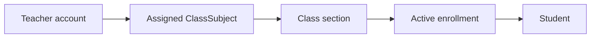
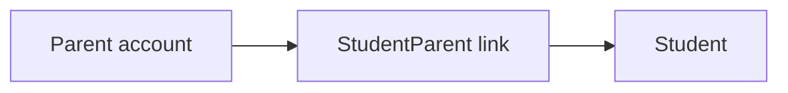

# Authorization architecture and audit

## Existing Authorization Audit Report

The Version 2 baseline already had database-backed `User`, `Role`, `Permission`, `UserRole`, and
`RolePermission` tables, JWT authentication, global authentication/permission guards, and an
initial set of role permissions. It also had role-oriented teacher, student, and parent portals.

The audit identified these risks before the scoped refactor:

| Area | Baseline risk | Refactor outcome |
| --- | --- | --- |
| Permissions | Broad module permissions could over-authorize actions | Granular `resource.action` permission catalog |
| Scope | Permission only proved a feature could be called | `GLOBAL`, `SCHOOL`, `ASSIGNED`, `LINKED`, and `OWN` grants |
| Teacher access | A valid teacher could query unrelated academic data | Assigned class-subject and database query policies |
| Student access | URL IDs could be used to request another learner | Own-profile policies and constrained queries |
| Parent access | A child selector could be trusted too much | Guardian-link verification in the database |
| Results visibility | Unpublished academic data could appear in portal queries | Student/parent marks, assignments, and report cards require publication |
| Frontend | Menu visibility was static | Permission-aware navigation and reusable `PermissionGate` |

## Module policies

| Policy | Applied to | Rule |
| --- | --- | --- |
| Student access | Students, enrollments, report cards, attendance summaries | School-wide, own learner, linked child, or an actively assigned teacher's class |
| Teacher assignment | Attendance, assignments, marks | The `TeachingAssignment.teacher.staff.userId` must equal the actor for `ASSIGNED` scope |
| Parent-child | Guardian actions | An explicit `StudentParent` relation must exist |
| Timetable/class-subject query | Timetable and teaching-assignment lists | Queries are restricted by assigned teacher, own enrollment, or linked-child enrollment |
| Assignment submission | Assignment reads | Students and parents receive only their own/linked submissions; teachers see their assigned work |
| Exam and marks | Exam listing and mark entry | Learners/parents receive published exams and their own/linked marks; teachers require assignment ownership |
| Report cards | Report-card listing and lifecycle | Learners/parents receive only `PUBLISHED` or `APPROVED` cards; Principal approval and admin publication are distinct permissions |

## Error handling

- `401 Unauthorized` means no valid active session/token was supplied.
- `403 Forbidden` means identity is known but the grant, scope, or object policy failed.
- `404 Not Found` is used where a record is absent in the current school; protected object-policy
  checks do not reveal internal authorization conditions.

## Adding a protected action

1. Create a granular permission in the seed catalog (for example, `payment.void`).
2. Add it to the appropriate role template with a scope.
3. Protect the route with `@RequirePermissions('payment.void')`.
4. Call a reusable policy in the service before loading/mutating the object.
5. Add a focused regression test for an out-of-scope caller and an audit event for sensitive
   changes.
