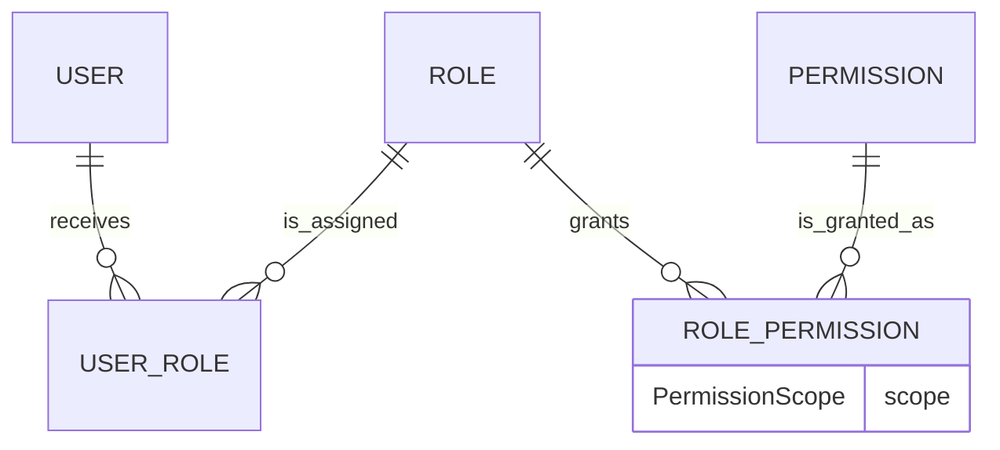
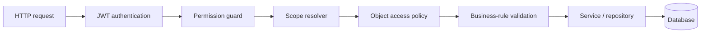

# RBAC and scoped authorization

## Purpose

Version 2 uses **RBAC + permission + scope + business-rule validation**. A role grants a
permission and a scope; a module policy then proves that the requested record is within that
scope. The API is the authority. The web application only hides actions which are not useful to
the signed-in user.

The schema keeps the existing `User`, `Role`, `Permission`, `UserRole`, and `RolePermission`
records. `Permission.module` and `Permission.action` describe a granular `resource.action` code.
`RolePermission.scope` is a `PermissionScope` enum, so a role may grant the same permission with
different scopes without changing application code.

## Scopes

| Scope      | Meaning                                                            | Typical holder   |
| ---------- | ------------------------------------------------------------------ | ---------------- |
| `GLOBAL`   | Every school and record in the platform                            | Super Admin      |
| `SCHOOL`   | Records belonging to the current school                            | Admin, Principal |
| `ASSIGNED` | Records related to a teacher's assigned class subjects             | Teacher          |
| `LINKED`   | Records explicitly related to the user, such as a guardian's child | Parent           |
| `OWN`      | The authenticated user's own profile or learner record             | Student          |

`GLOBAL` is accepted anywhere that `SCHOOL` is accepted when that specific permission is granted.
A platform Super Admin receives only platform permissions. If a legacy account also carries a
school role, authentication uses only its Super Admin assignment so operational permissions
cannot leak into the platform session.

## Default roles

| Role          | Default scope | Responsibility                                                                         |
| ------------- | ------------- | -------------------------------------------------------------------------------------- |
| `SUPER_ADMIN` | `GLOBAL`      | Schools, School Admin onboarding, global role templates, and platform audit            |
| `ADMIN`       | `SCHOOL`      | Users, staff, learners, academics, finance, communication, and settings for one school |
| `PRINCIPAL`   | `SCHOOL`      | School-wide review and report-card approval                                            |
| `TEACHER`     | `ASSIGNED`    | Assigned teaching, attendance, assignments, and marks                                  |
| `STUDENT`     | `OWN`         | Own learning and academic data                                                         |
| `PARENT`      | `LINKED`      | Explicitly linked children only                                                        |
| `ACCOUNTANT`  | `SCHOOL`      | Finance-relevant data only                                                             |
| `LIBRARIAN`   | `SCHOOL`      | Library operations and limited student lookup                                          |

These are system role templates. Super Admin manages the global role templates. School Admin may
assign permitted school roles to users in its own school, but cannot change platform permissions
or assign the Super Admin role.

## Safe migration strategy

1. Back up the database and existing authorization tables.
2. Add `PermissionScope`, `Permission.module`, `Permission.action`, and
   `RolePermission.scope` with a `SCHOOL` default. Existing grants therefore remain usable.
3. Seed the eight official role templates and granular permissions idempotently.
4. Preserve current user-role assignments; reload authorization context from the database on each
   protected request.
5. Update module queries and policies one module at a time, then run the authorization tests.

The migrations in `packages/database/prisma/migrations/20261028090000_permission_scopes` and
`20261028093000_report_card_publication` follow this strategy. Existing report cards were marked
published during the latter migration so Version 2 historical cards remain visible to their
students and guardians.

## Request lifecycle

Authentication validates the token, session, account status, and authorization version. The
permission guard only tests for `resource.action`; it does not contain class, child, or record
rules. `AuthorizationService` resolves scopes and provides reusable policy methods such as
`studentWhere`, `assertStudentAccess`, `assertTeachingAssignmentAccess`, and
`assertParentChildAccess`.
